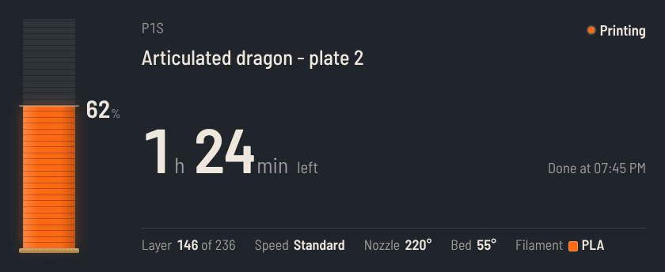

# iCUE Widgets

Custom widgets for CORSAIR iCUE, made for the XENEON EDGE.

## Widgets

| | Widget | What it does |
|---|---|---|
|  | **[Bambu Print Status](widgets/bambu-print-status/)** | Live Bambu Lab 3D print progress, time left, layers, temperatures and loaded filament, with funky themes and custom colors. Needs a small bridge app on your PC. |
|  | **[Discord Server](widgets/discord-server/)** | Who's in which voice channel (with mute and deafen), who's online and what they're playing, plus member counts. Tap a voice channel to jump to it in Discord. Needs the server widget turned on in Discord. |

## Install a widget

1. Open the [latest release](../../releases/latest) and download the widget's `.icuewidget` file, plus any extra files listed in that widget's README.
2. Double-click the `.icuewidget` file, or click **+** in iCUE's widget panel and choose it.
3. Add the widget to your XENEON EDGE and open its settings in iCUE to customize it.

Requires Windows and iCUE 5.47 or newer. Some widgets need extra setup, so check each widget's README.

## Repository layout

```
widgets/
  <widget-name>/
    <WidgetFolder>/     the widget itself (index.html, manifest.json, ...)
    bridge/             optional helper app (zipped automatically if present)
    docs/               screenshots
    README.md           setup and usage for this widget
.github/workflows/      builds every widget automatically
```

## Add a new widget

```
npm install -g icuewidget-cli
mkdir widgets/my-widget
cd widgets/my-widget
icuewidget init MyWidget
```

Build it, then add a row to the table above and a `README.md` in its folder. The Build workflow finds it automatically: any folder under `widgets/` that contains a `manifest.json` is validated and packaged as `<widget-name>.icuewidget`.

To check a widget locally:

```
icuewidget validate widgets/my-widget/MyWidget
icuewidget package widgets/my-widget/MyWidget -o dist/my-widget.icuewidget
```

## Releasing

1. Bump `version` in the `manifest.json` of each widget you changed.
2. On GitHub, go to **Releases > Draft a new release**, create a new tag (for example `v2026.11.0`) and publish.
3. The Build workflow packages every widget and attaches the `.icuewidget` files and bridge zips to the release. You can watch it in the **Actions** tab.

Every push to `main` also validates all widgets, so a broken widget shows up as a failed check.

## Disclaimer

These are independent community projects. They are not affiliated with, endorsed by or supported by CORSAIR or any other brand mentioned. CORSAIR, iCUE and XENEON are trademarks of CORSAIR. Bambu Lab, Discord and other names are trademarks of their respective owners.

## License

[MIT](LICENSE)
