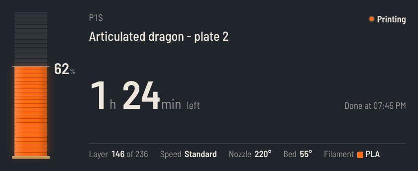
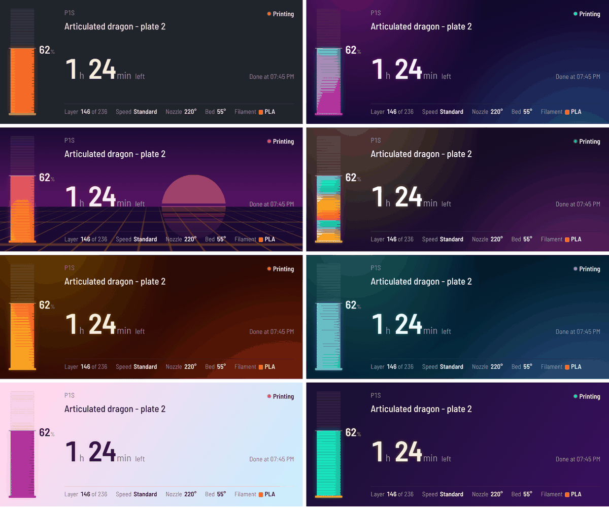
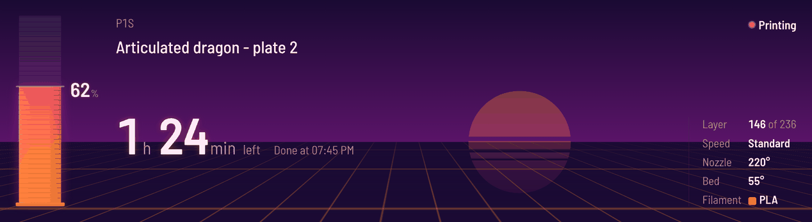

# Bambu Print Status for CORSAIR XENEON EDGE

An iCUE widget that shows your Bambu Lab 3D print live on the XENEON EDGE: progress, time left, finish time, layers, temperatures and the filament that's loaded. It comes with funky themes and fully custom colors.



- Progress drawn as a part being printed layer by layer, in your loaded filament's color
- Time left, "Done at" time, layer count, print speed, nozzle and bed temperatures
- Clear screens for preparing, paused, finished, cancelled, failed, idle and offline
- 7 themes plus custom colors, 4 background styles, rainbow progress, glow, 5 fonts
- Confetti when a print finishes
- Works in every XENEON EDGE slot size, horizontal or vertical



## How it works

```
Bambu printer  --(LAN, read-only)-->  bridge on your PC  --(localhost:8765)-->  iCUE widget
```

iCUE widgets run in a browser engine, which can't open the encrypted MQTT connection Bambu printers use. A small Node.js **bridge** runs on your PC, reads the printer's status over your home network and serves it to the widget at `http://localhost:8765/status`. It never sends commands to the printer, and it only listens on your own PC.

## Requirements

- Windows with iCUE 5.47 or newer and a CORSAIR XENEON EDGE
- [Node.js](https://nodejs.org) 18 or newer (LTS recommended)
- A Bambu Lab printer on the same network as the PC (X1, P1, A1 and H2 series; H2 temperatures are best effort)

## Install

1. Download **`bambu-print-status.icuewidget`** and **`bambu-print-status-bridge.zip`** from the [latest release](../../../../releases/latest) (the Releases section on the repository's main page).
2. Extract `bambu-print-status-bridge.zip`, copy `config.example.json` to `config.json` and fill in your printer's details (see below).
3. Double-click **`start-bridge.bat`**. The first run installs dependencies. You should see `connected to printer`.
4. Double-click **`bambu-print-status.icuewidget`** to import it into iCUE, allow the localhost permission, and add the widget to your XENEON EDGE.

### config.json

```json
{
  "printerName": "My P1S",
  "printerIp": "192.168.1.50",
  "serial": "01P00A000000000",
  "accessCode": "12345678",
  "port": 8765
}
```

Keep the quotes around every value except `port`. Leave `port` at 8765 unless something else on your PC uses it (then change the widget's Bridge address to match).

### Where to find your printer's details

| Printer | IP address and access code | Serial number |
|---|---|---|
| X1 / X1 Carbon / X1E | Settings, Network tab | Settings, General tab |
| P1S / P1P | Settings, WLAN (press OK) | Bottom of the Settings list |
| A1 / A1 mini | Settings, page 3, LAN Only Mode | Settings, page 2, Device |

The serial number is also shown in Bambu Studio under **Device > Update**, and on the label on the printer.

Tips:
- Give the printer a fixed IP (a DHCP reservation in your router), or the address may change after a restart.
- The access code changes when you turn LAN Only mode on or off.
- LAN Only mode and Developer Mode are not needed to read status. If the connection is refused, try enabling LAN Only mode.

## Customize the look

Select the widget on the XENEON EDGE in iCUE to open its settings.

| Setting | Options |
|---|---|
| Theme | Classic, Neon, Synthwave, Disco, Lava lamp, Aurora, Bubblegum, Custom colors |
| Background style | Match theme, Solid, Gradient, Floating glow, Retro grid |
| Progress style | Match theme, Filament color, Theme color, Gradient, Rainbow |
| Font | Technical, Clean, Chunky, Handwritten, Code |
| Glow | 0 to 100% |
| Background opacity | 0 to 100% (lower it to show your EDGE wallpaper) |
| Animations, Confetti | On or off |

For your own colors, set **Theme** to **Custom colors**, pick Background, Background 2, Text, Accent and Progress colors, and turn on **Custom Style** in that panel.



## Try it without a printer

Run `start-demo.bat`. The bridge simulates a print that loops through preparing, printing, paused, finished (with confetti) and idle.

## Start the bridge with Windows

Press Win+R, type `shell:startup`, and put a shortcut to `start-bridge.bat` in that folder.

## Troubleshooting

| The widget says | What to do |
|---|---|
| Start the bridge | `start-bridge.bat` isn't running, or the widget's Bridge address doesn't match `port` in config.json. |
| Printer not connected | Read the message under it. Usually a wrong IP or access code. |
| No update from the printer | The printer is asleep or dropped off Wi-Fi. The bridge reconnects automatically. |
| Print cancelled / Print failed | This is the printer's last job. It changes as soon as you start a new print. |

Open `http://localhost:8765/raw` in a browser to see everything the printer reports.

If `start-bridge.bat` says Node.js is not installed, install the LTS version from [nodejs.org](https://nodejs.org) and run it again (restart the PC if it still isn't found).

## Development

```
BambuPrintStatus/   the iCUE widget (HTML, CSS, JS, manifest)
bridge/             the Node.js bridge
docs/               screenshots used in this README
```

From the repository root:

```
icuewidget validate widgets/bambu-print-status/BambuPrintStatus
icuewidget package widgets/bambu-print-status/BambuPrintStatus -o dist/bambu-print-status.icuewidget
```

Open `BambuPrintStatus/index.html` in a browser while `start-demo.bat` is running to preview changes.

Bridge endpoints: `/status` (what the widget uses) and `/raw` (the full merged printer report, for debugging).

Before releasing a new version, bump `version` in `BambuPrintStatus/manifest.json`. See the [main README](../../README.md#releasing) for how releases work.

## Credits

The printer protocol details come from the community's [OpenBambuAPI](https://github.com/Doridian/OpenBambuAPI) documentation.

## Disclaimer

This is an independent community project. It is not affiliated with, endorsed by or supported by Bambu Lab or CORSAIR. Bambu Lab, CORSAIR, iCUE and XENEON are trademarks of their respective owners.

## License

[MIT](../../LICENSE)
