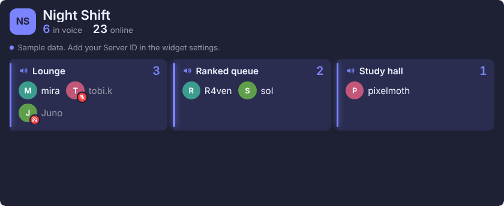
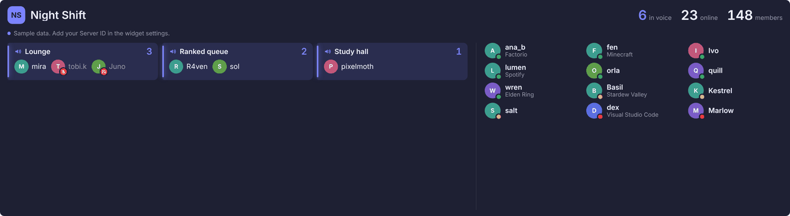

# Discord Server widget for iCUE (XENEON EDGE)



Shows your Discord server on the XENEON EDGE: who is in which voice channel
(with mute and deafen state), who else is online and what they are playing,
plus online and member counts. Tap a voice channel to jump to it in Discord.

## 1. Turn on your server's widget feed (once)

You need the Manage Server permission on the server.

1. In Discord, open **Server Settings > Engagement** and scroll to **Server Widget**.
2. Turn on **Enable Server Widget**, then click **Save Changes** in the bar at the bottom.
3. Copy the **Server ID** shown in that section.
4. Optional: pick an **Invite Channel** in the same section. This lets the widget show the server
   icon and the total member count.

Note: turning this on makes the same information (server name, voice
channels everyone can join, online members) readable by anyone who knows the
Server ID. That is how Discord's own website embed works.

## 2. Install

Download **`discord-server.icuewidget`** from the [latest release](../../../../releases/latest) (the Releases section on the repository's main page).

In iCUE: select the XENEON EDGE, open the widgets section, click **+** above
the widget list and pick the `.icuewidget` file. Approve the network access
for discord.com and discordapp.com when asked.

To build it yourself, from the repository root:

```
npm install -g icuewidget-cli
icuewidget package widgets/discord-server/DiscordServer -o dist/discord-server.icuewidget
```

## 3. Settings

| Setting | What it does |
|---|---|
| Server ID | Paste the ID (or the whole widget URL, the ID is picked out of it). Empty shows sample data. |
| Refresh every | How often to ask Discord for new data (30 to 600 s). Discord itself updates the feed about once a minute. |
| Tapping opens | Discord app (`discord://` link) or the browser. |
| Show online members | The right-hand list of online people who are not in voice. |
| Show what people are playing | Game or app name under each person. |
| Show empty voice channels | Lists voice channels with nobody in them too. |
| Colors, Transparency | Used when Custom Style is on for the XENEON EDGE. |

The layout adapts to the tile and to what's happening on the server:

- Square and tall tiles stack the voice channels above the online list.
- Wide tiles (half or full panel) put them side by side. The voice column
  grows with the number of busy channels.
- When nobody is in voice, that area shrinks to one line and the online list
  takes the space. With few people online, their rows get bigger.
- Short tiles show voice channels when someone is talking, otherwise the
  online list. Small tiles show the counts and a row of faces.



## Limits of Discord's widget feed

- Only voice channels that @everyone can join are included.
- At most 100 online members are listed; offline members never are.
- No message content, no unread counts, no "who is speaking" indicator.
  Those need a logged-in Discord client connection, which this widget does
  not use.

## Testing in a browser

Open `DiscordServer/index.html` directly. Add `?server=YOUR_SERVER_ID` to the URL to load
your real server instead of the sample data.

## Files

```
DiscordServer/
  manifest.json      widget metadata, network permissions, Link plugin
  index.html         settings (x-icue-property) and markup
  styles/main.css    layout and responsive tile sizes
  scripts/widget.js  data loading and rendering
  translation.json   labels for the iCUE settings panel
  resources/         icon.svg, preview.png
```

See the [main README](../../README.md) for the other widgets and how releases work.

Not affiliated with or endorsed by Discord or CORSAIR. [MIT license](../../LICENSE).
